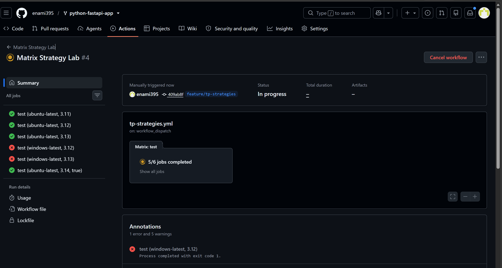
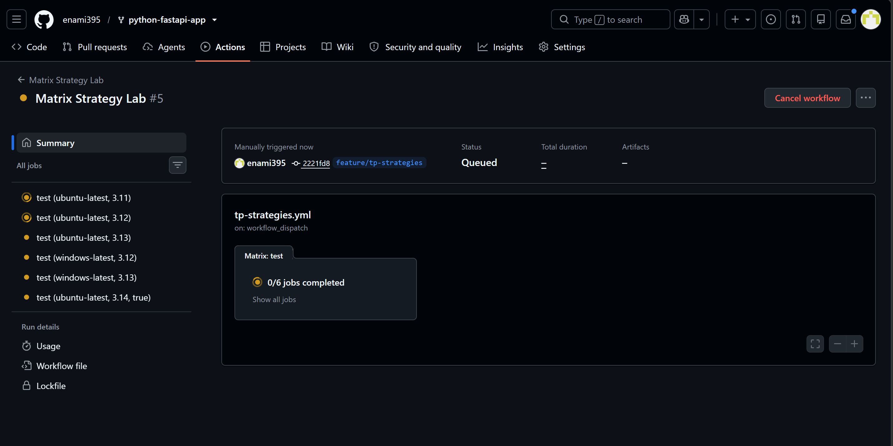
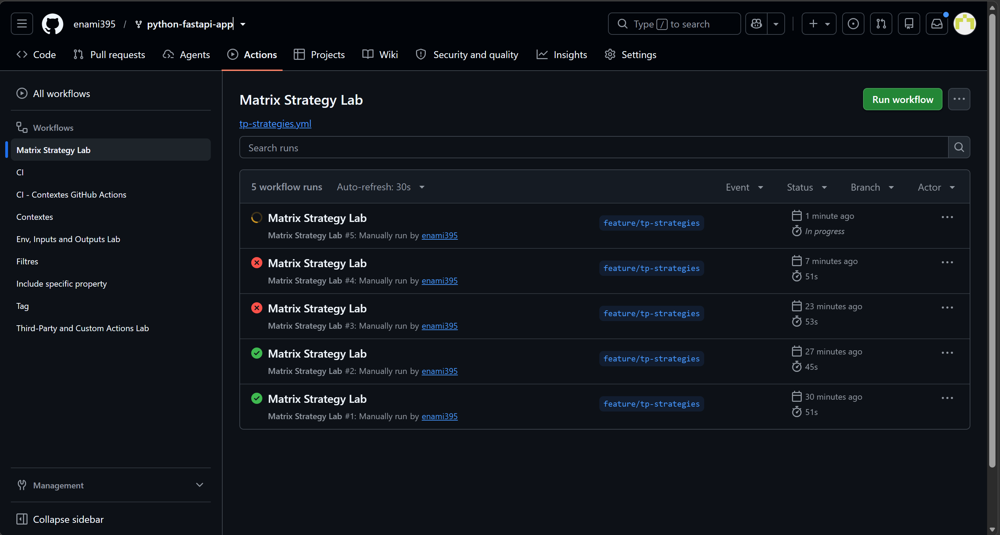

# TP 8 – Stratégies GitHub Actions

## Partie 1 – La matrice de base

### Q1. Combien de jobs sont générés ? Donnez la liste des combinaisons.

La matrice génère **6 jobs** : chaque valeur de `os` (2 valeurs) est combinée avec chaque valeur de `python-version` (3 valeurs), soit 2 × 3 = 6.

| # | os | python-version |
| --- | --- | --- |
| 1 | ubuntu-latest | 3.11 |
| 2 | ubuntu-latest | 3.12 |
| 3 | ubuntu-latest | 3.13 |
| 4 | windows-latest | 3.11 |
| 5 | windows-latest | 3.12 |
| 6 | windows-latest | 3.13 |

Le même job `test` est écrit une seule fois : GitHub le duplique pour chaque combinaison, en remplaçant `${{ matrix.os }}` et `${{ matrix.python-version }}` par les valeurs correspondantes.

## Partie 2 – exclude et include

### Q2. Combien de jobs au total ?

**6 jobs.** Le calcul se fait en trois temps :

1. **Matrice de base :** 2 × 3 = 6 combinaisons.
2. **`exclude` (appliqué en premier) :** `windows-latest` + `3.11` est retiré, il reste 5 combinaisons.
3. **`include` (appliqué ensuite) :** `ubuntu-latest` + `3.14` ne correspond à aucune combinaison existante, car `3.14` n'est pas dans la liste `python-version`. Il crée donc un nouveau job, ce qui donne 6 jobs.

| # | os | python-version | experimental |
| --- | --- | --- | --- |
| 1 | ubuntu-latest | 3.11 | |
| 2 | ubuntu-latest | 3.12 | |
| 3 | ubuntu-latest | 3.13 | |
| 4 | windows-latest | 3.12 | |
| 5 | windows-latest | 3.13 | |
| 6 | ubuntu-latest | 3.14 | true |

Grâce à `continue-on-error: ${{ matrix.experimental == true }}`, un échec du job 3.14 ne fait pas échouer le workflow. Pour les 5 autres jobs, l'expression vaut `false` : un échec reste bloquant.

### Q3. Que se passerait-il si vous tentiez d'exclure la combinaison 3.14 ? Pourquoi ?

L'exclusion n'aurait **aucun effet** : le job 3.14 serait quand même créé.

`exclude` s'applique avant `include`, et seulement sur la matrice de base, construite à partir des listes `os` et `python-version`. Or `3.14` n'est pas dans la liste `python-version` : la combinaison `ubuntu-latest` + `3.14` n'existe pas encore au moment où `exclude` est appliqué, il n'y a donc rien à retirer. `include` l'ajoute ensuite.

## Partie 3 – fail-fast

Échec contrôlé ajouté temporairement dans `tests/test_break.py` :

```python
import sys


def test_break():
    assert sys.platform != "win32"   # échoue uniquement sur Windows
```

### Q4. Quelle est la différence observée ? Dans quel cas choisiriez-vous true ? false ?

**Résultats observés :**

| Job | `fail-fast: true` (run #3) | `fail-fast: false` (run #4) |
| --- | --- | --- |
| ubuntu-latest, 3.11 | réussi | réussi |
| ubuntu-latest, 3.12 | réussi | réussi |
| ubuntu-latest, 3.13 | réussi | réussi |
| ubuntu-latest, 3.14 (experimental) | réussi | réussi |
| windows-latest, 3.12 | **annulé** | échoué |
| windows-latest, 3.13 | échoué | échoué |

Avec `fail-fast: true`, l'échec de `windows-latest, 3.13` a provoqué l'annulation de `windows-latest, 3.12`, qui tournait encore. Les jobs Ubuntu, plus rapides, étaient déjà terminés et ont gardé leur résultat. Avec `fail-fast: false`, aucun job n'est annulé : les deux jobs Windows vont jusqu'au bout et échouent tous les deux.



**Explication :**

- **`fail-fast: true` (par défaut) :** dès qu'un job de la matrice échoue, GitHub annule tous les jobs encore en cours ou en attente. Les jobs déjà terminés gardent leur résultat. On obtient vite un signal d'échec, mais on ne sait pas si les combinaisons annulées auraient réussi.
- **`fail-fast: false` :** un échec n'interrompt pas les autres jobs. Tous vont jusqu'au bout, et on obtient le résultat complet de chaque combinaison.

**Quand choisir `true` :** quand un seul échec suffit à bloquer la livraison et qu'on veut économiser du temps et des minutes de runner, par exemple sur une pull request ou un pipeline de déploiement.

**Quand choisir `false` :** quand on veut savoir précisément quelles combinaisons échouent, par exemple pour diagnostiquer un problème propre à un système ou à une version de Python. C'est le cas ici : seul Windows échoue, et seul `fail-fast: false` le montre clairement.

## Partie 4 – max-parallel

```yaml
    strategy:
      fail-fast: false
      max-parallel: 2
      matrix:
```

Avec `max-parallel: 2`, GitHub n'exécute que 2 jobs de la matrice à la fois. Les 4 autres restent en attente (« Queued ») et démarrent dès qu'un job se termine. Le run dure plus longtemps, mais n'occupe jamais plus de 2 runners en même temps.

**Observé (run #5) :** au lancement, seuls `ubuntu-latest, 3.11` et `ubuntu-latest, 3.12` sont en cours. Les 4 autres jobs sont en attente.



Les jobs démarrent ensuite au fur et à mesure que des places se libèrent :

| Job | Démarrage (depuis le premier job) |
| --- | --- |
| ubuntu-latest, 3.11 | 0 s |
| ubuntu-latest, 3.12 | 0 s |
| ubuntu-latest, 3.13 | 17 s |
| windows-latest, 3.12 | 17 s |
| windows-latest, 3.13 | 34 s |
| ubuntu-latest, 3.14 (experimental) | 49 s |

Il n'y a jamais plus de 2 jobs en cours en même temps.

## Historique des exécutions

Tous les runs du workflow « Matrix Strategy Lab » ont été lancés manuellement sur la branche `feature/tp-strategies` :

| Run | Partie | Configuration | Résultat |
| --- | --- | --- | --- |
| #1 | Partie 1 | matrice de base, 6 jobs | réussi |
| #2 | Partie 2 | `exclude` Windows 3.11, `include` Ubuntu 3.14 | réussi |
| #3 | Partie 3 | `test_break.py`, `fail-fast: true` | échoué (Windows), un job annulé |
| #4 | Partie 3 | `test_break.py`, `fail-fast: false` | échoué (Windows), aucun job annulé |
| #5 | Partie 4 | `max-parallel: 2`, test temporaire supprimé | en cours au moment de la capture |

Les runs #3 et #4 échouent volontairement, à cause du test `test_break.py` qui ne passe pas sous Windows.



### Q5. Donnez deux raisons d'utiliser max-parallel en entreprise.

1. **Limiter la consommation de ressources et les coûts :** le nombre de runners disponibles est limité (quota de jobs simultanés du compte, ou nombre de machines pour des runners auto-hébergés), et les minutes de runner sont facturées. Limiter le parallélisme évite qu'une seule matrice monopolise tous les runners et bloque les pipelines des autres équipes.
2. **Protéger les systèmes partagés :** quand les tests utilisent une ressource commune (base de données de test, environnement de recette, API externe avec une limite de requêtes), trop de jobs simultanés peuvent la surcharger ou se gêner entre eux et provoquer des échecs aléatoires. `max-parallel` limite le nombre d'accès simultanés.
