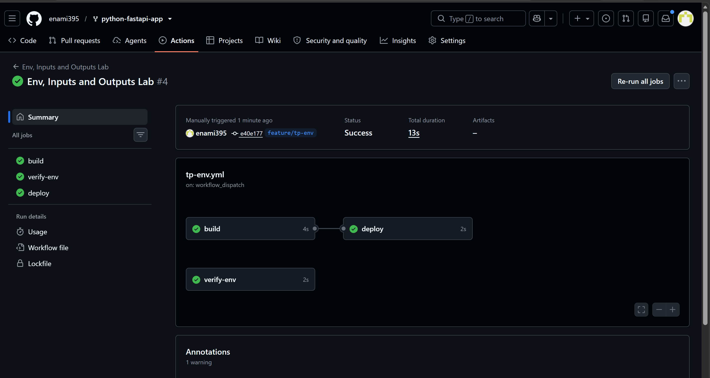
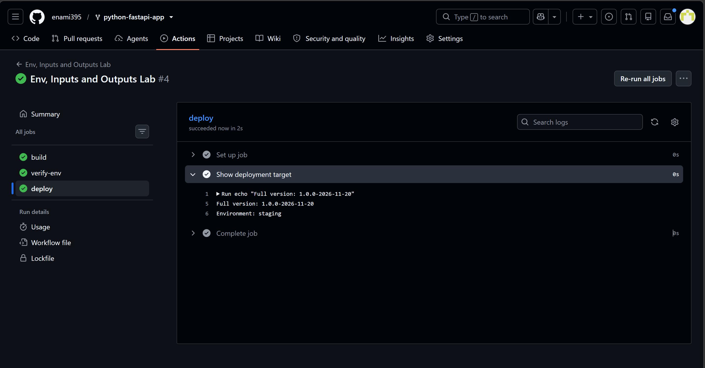

# TP 6 – Variables d'environnement, Inputs et Outputs

## Partie 1 – Variables d'environnement avec GITHUB_ENV

### Q1. Pourquoi la variable n'est-elle pas disponible dans la step qui l'a définie, mais seulement dans les suivantes ?

Chaque step s'exécute dans un nouveau processus shell. `echo "APP_NAME=my-app" >> $GITHUB_ENV` n'exporte pas la variable dans le shell en cours : la ligne est seulement écrite dans un fichier. Le runner lit ce fichier à la fin de la step, puis injecte les variables dans l'environnement des steps suivantes du job.

Dans la step « Set environment variables », la ligne `Same step: APP_NAME=''` le confirme : la variable est vide dans la step qui l'a définie. Elle est ensuite affichée par « Print environment variables ».

### Q2. Que constatez-vous dans le job verify-env ? Quelle est la portée de GITHUB_ENV ?

`$APP_NAME` est vide dans le job `verify-env` : la step affiche `APP_NAME in another job: ''`.

La portée de `GITHUB_ENV` est donc **le job** : une variable écrite dans `GITHUB_ENV` est disponible dans les steps suivantes du même job, mais pas dans les autres jobs. Chaque job tourne sur sa propre machine virtuelle, avec son propre environnement. Pour transmettre une valeur à un autre job, il faut passer par les outputs (`GITHUB_OUTPUT`) et `needs`.

## Partie 3 – Outputs : passer des données entre deux jobs

### Q3. Que se passe-t-il si vous écrivez > au lieu de >> dans GITHUB_OUTPUT alors que deux outputs sont définis dans la même step ?

`>` vide le fichier avant d'écrire, alors que `>>` ajoute une ligne à la fin. Avec `>`, la seconde écriture efface la première : seul le dernier output reste dans `GITHUB_OUTPUT`. Le premier output est perdu, et toute expression qui le lit renvoie une chaîne vide, sans message d'erreur.

### Q4. Pourquoi GITHUB_ENV ne suffit-il pas ici, alors que GITHUB_OUTPUT fonctionne entre jobs ?

`GITHUB_ENV` a pour portée le job : ses variables n'existent que dans les steps suivantes du même job, sur la même machine virtuelle (voir Q2). Le job `deploy` tourne sur une autre machine et ne les voit pas.

`GITHUB_OUTPUT` crée un output de step (`steps.version.outputs.full_version`). Déclaré dans `outputs:` au niveau du job `build`, il devient un output du job. GitHub le conserve après la fin du job, et les jobs qui dépendent de `build` peuvent le lire avec `needs.build.outputs.full_version`.

### Q5. Que se passe-t-il si vous retirez needs: build du job deploy ?

`deploy` ne dépend plus de `build` : les deux jobs démarrent en même temps, en parallèle. Le contexte `needs` de `deploy` ne contient alors plus `build`, donc `${{ needs.build.outputs.full_version }}` renvoie une chaîne vide. La step affiche `Full version: ` sans valeur, même si `build` réussit. `deploy` s'exécuterait aussi si `build` échouait.

`needs` sert donc à la fois à fixer l'ordre d'exécution et à donner accès aux outputs d'un autre job.

