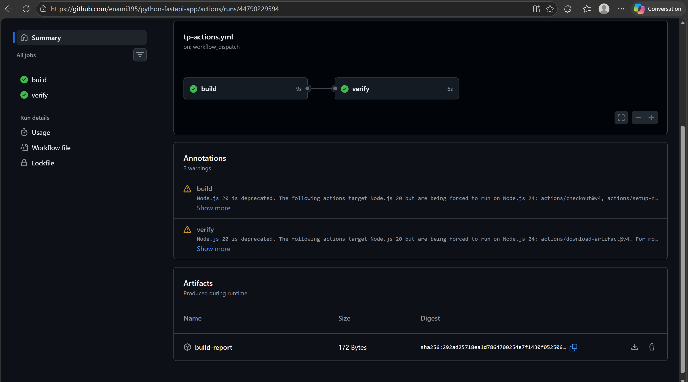
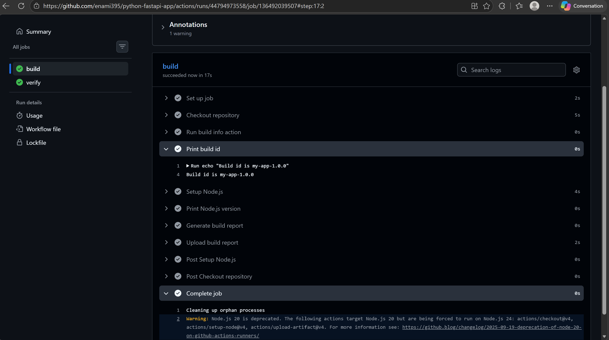
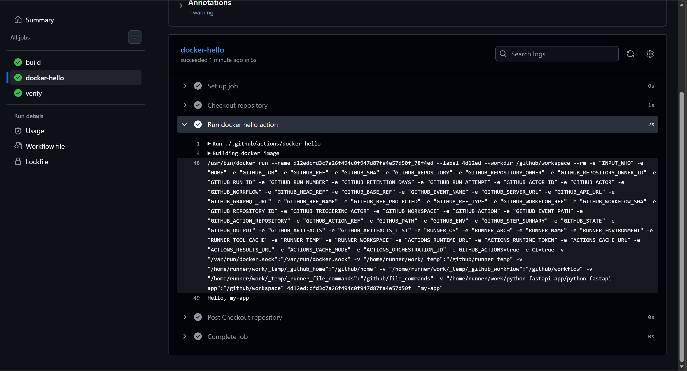

# TP 7 – Actions tierces et actions personnalisées

## Partie 1 – Utiliser des actions tierces (uses et with)

### Q1. Pourquoi actions/checkout n'a-t-il pas besoin de with alors que setup-node en a besoin ?

Tous les paramètres de `actions/checkout` sont facultatifs et ont une valeur par défaut adaptée : par défaut, il récupère le dépôt du workflow, au commit qui a déclenché le run. Sans `with`, il fait donc déjà ce qu'on attend de lui.

`actions/setup-node` doit savoir quelle version de Node.js installer, et il n'a pas de version par défaut. Sans `node-version`, il n'installe rien et laisse la version déjà présente sur le runner, qui peut changer d'une image à l'autre. `with: node-version: 20` fixe la version utilisée et rend le build reproductible.

### Q2. Pourquoi le job verify ne retrouve-t-il pas report.txt sans l'artefact, alors que les deux jobs partagent le même dépôt ?

Chaque job tourne sur sa propre machine virtuelle, neuve et vide. `report.txt` est créé pendant le job `build`, sur sa machine, et disparaît quand ce job se termine.

Partager le même dépôt ne suffit pas : `actions/checkout` ne récupère que les fichiers commités, et `report.txt` n'est jamais commité. Le job `verify` ne fait d'ailleurs pas de checkout.

L'artefact sert de stockage intermédiaire : `upload-artifact` envoie le fichier sur GitHub à la fin de `build`, et `download-artifact` le récupère dans `verify`. `needs: build` garantit que l'artefact existe avant le téléchargement.

### Exécution réussie avec l'artefact build-report

Run lancé sur `feature/tp-actions` : `build` puis `verify` réussissent, et l'artefact `build-report` (172 octets) apparaît dans la section Artifacts.

## Partie 3 – Créer une action composite locale

L'action composite `build-info` renvoie l'identifiant `my-app-1.0.0`, affiché par la step « Print build id ».

### Q6. Pourquoi actions/checkout doit-il s'exécuter avant l'appel d'une action locale ?

Une action locale est désignée par un chemin dans le dépôt (`uses: ./.github/actions/build-info`). Le runner lit son fichier `action.yml` dans le dossier de travail du job.

Au début d'un job, ce dossier est vide : le code du dépôt n'est pas présent sur la machine. C'est `actions/checkout` qui le télécharge. Sans checkout préalable, le runner ne trouve pas `action.yml` et le job échoue.

### Q7. Pourquoi shell: bash est-il obligatoire sur les steps run d'une action composite ?

Dans un workflow, une step `run` sans `shell` utilise un shell par défaut, `bash` sur Linux, ou celui défini dans `defaults.run`. Une action composite n'hérite pas de ces valeurs par défaut : elle peut être appelée depuis n'importe quel workflow, sur n'importe quel système (Linux, Windows, macOS).

GitHub exige donc que chaque step `run` d'une action composite indique explicitement son shell, pour que l'action se comporte de la même façon partout. Sans `shell`, le fichier `action.yml` est refusé et le job échoue.

## Partie 4 – Action Docker

L'action `docker-hello` affiche `Hello, my-app`. La step « Run docker hello action » commence par construire l'image (« Building docker image »), puis lance le conteneur avec `docker run`.

